# Inpaint

A Linux desktop photo library and image editor with local AI object removal,
watermark removal, face replacement, restoration, upscaling, and background
tools. Browse folders, image stores and Immich libraries, double-click a picture,
and combine edits without reloading models between operations.

Inpaint edits PNG, JPEG, WebP and animated GIF files, and opens BMP and TIFF.
Processing stays on your computer; the application only uses the network to
install dependencies, download model weights, and talk to Immich when you use it.

> [!WARNING]
> Saving overwrites the original image. The application does not create a
> backup, so keep a copy of anything you cannot replace.

[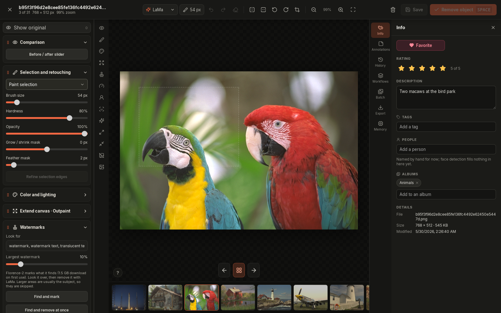](docs/screenshots/editor.webp)

## Contents

- [Features](#features)
- [Install and run](#install-and-run)
- [Browsing pictures](#browsing-pictures)
- [Editing](#editing)
- [AI tools](#ai-tools)
- [Workflows, batch processing, and export](#workflows-batch-processing-and-export)
- [Drop box](#drop-box)
- [Local API server](#local-api-server)
- [Browser extension](#browser-extension)
- [System tray](#system-tray)
- [Build an executable or package](#build-an-executable-or-package)
- [License](#license)

Screenshot notes and demo photo credits are in [docs/screenshots](docs/screenshots/README.md).
Click any screenshot to view it at full size.

## Features

**Library**

- Folder tree and a fast, virtualized thumbnail gallery in a grid or masonry layout.
- Image stores for folders laid out like Immich uploads, rescanned in the background.
- Albums (nested, with covers) and tags, kept in Inpaint or in Immich, with marks on each thumbnail.
- Ordering by date modified, date added, star rating or name, and filters for tagged, album and favourite pictures.
- Favourite, rating, description, tags and people for every picture, plus annotations pinned to parts of a picture.
- Immich integration: albums, tags, favourites and ratings, thumbnail refresh after saving, and pictures from external libraries.
- Animated GIFs play in the gallery and the editor.

**Editing**

- Mask painting with adjustable brush, smooth zoom and pan, and a picture strip for moving between pictures.
- Smart selection, clone and healing brushes, live color adjustments, crop and straighten with handles, flips and rotations.
- Undo/redo with a visual edit history; edits to an animated GIF are applied to every frame on save.
- Shortcuts for every tool, which you can change.

**AI tools**

- Five selectable inpainting models for different kinds of repair.
- Watermark detection and removal with Florence-2.
- Photo upscalers that keep real texture (DAT2 and ATD), RealESRGAN and Real-HAT, and plain resizing.
- Detail restoration without upscaling: JPEG cleanup, added detail, noise removal, and motion deblurring.
- GFPGAN face restoration and face replacement from a source photo.
- Background removal and replacement with a color, an image or a blur, plus cutout edge refinement.
- Canvas extension (outpainting).
- A persistent worker that keeps every used model loaded between edits.

**Automation and integration**

- Reusable workflows, batch queues and export copies.
- A local HTTP API for every operation, and a browser extension that uses it.
- A drop box: drag pictures from a browser, a file manager or the clipboard into a store.

## Install and run

### Platform and hardware

The application currently supports Linux only, on x86-64.

An NVIDIA CUDA GPU is strongly recommended. The runtime uses CUDA 12.8 PyTorch
wheels, so a recent compatible NVIDIA driver is required; a separate CUDA Toolkit
is normally not necessary. The models can fall back to the CPU, but most of them
will be impractically slow. GPU memory requirements vary by model and image:
LaMa, MAT, ZITS, and MIGAN are the lighter inpainting choices, while SDXL is
substantially larger and benefits from a GPU with generous VRAM.

The interface is drawn by WebKitGTK on the GPU. With NVIDIA's proprietary driver,
WebKit's usual way of handing frames to the window shows a blank white window, so
Inpaint passes them through shared memory there instead. If the window stays white
or draws badly, start Inpaint with `INPAINT_RENDERER=software` (slower scrolling
in large galleries), or with `INPAINT_RENDERER=gpu` to use WebKit's default. WebKit
variables you set yourself, such as `WEBKIT_DISABLE_DMABUF_RENDERER`, are left alone.

### AppImage

`inpaint-desktop.AppImage` packages the Linux desktop libraries and runs on
distributions with glibc 2.35 or newer, such as Linux Mint 21, Ubuntu 22.04,
Debian 12 and later releases. Graphics drivers remain a host requirement. If the
destination lacks FUSE, run it with `--appimage-extract-and-run`.

On first launch, the setup screen installs a private Python 3.11 runtime and its
dependencies with the embedded uv installer, whatever Python the system has.
Choose NVIDIA/CUDA or CPU. Setup shows progress and logs, can be retried after a
failed download, replaces an environment made earlier with another Python
version, and checks that every package loads before finishing. The first
installation requires internet and several gigabytes of free disk space.

Runtime data goes into `$XDG_DATA_HOME/inpaint-desktop` (normally
`~/.local/share/inpaint-desktop`). `INPAINT_PROJECT_DIR` overrides the location.
Model weights download on first use, with progress, and are reused from disk
afterwards. Some Hugging Face models require approval from their publisher.

### Run from source

Install the build prerequisites:

- Git
- Node.js 20 or newer and npm
- Rust stable and Cargo (installation through [rustup](https://rustup.rs/) is recommended)
- Tauri's Linux/WebKitGTK development libraries
- ImageMagick, recommended for fast gallery thumbnails
- ExifTool, optional; required for the drop box's per-store **Clear metadata** option
- Docker or Podman, only for building the AppImage

Fedora:

```bash
sudo dnf group install "C Development Tools and Libraries"
sudo dnf install \
  webkit2gtk4.1-devel libsoup3-devel openssl-devel libappindicator-gtk3-devel \
  librsvg2-devel nodejs npm git curl wget file ImageMagick
curl --proto '=https' --tlsv1.2 -sSf https://sh.rustup.rs | sh
```

Ubuntu / Debian:

```bash
sudo apt update
sudo apt install \
  build-essential libwebkit2gtk-4.1-dev libssl-dev \
  libsoup-3.0-dev libayatana-appindicator3-dev librsvg2-dev \
  git curl wget file imagemagick
```

On Ubuntu and Debian, install Node.js 20+ from your preferred Node.js source and
Rust with [rustup](https://rustup.rs/); distribution repositories sometimes carry
versions too old for current Tauri tooling. For other distributions, follow the
[Tauri 2 Linux prerequisites](https://v2.tauri.app/start/prerequisites/).

Clone the repository, install the dependencies and start the app:

```bash
git clone git@github.com:cthackers/inpaint.git
cd inpaint
npm install
./scripts/setup-model.sh          # NVIDIA GPU (CUDA 12.8)
./scripts/setup-model.sh --cpu    # no NVIDIA GPU
npm run desktop
```

The model setup script creates `.venv/` inside the project with its own Python
3.11, whatever Python the system has: it uses the same bundled `uv` as the app's
installer, downloads Python 3.11 when needed, and replaces a `.venv` made earlier
with another Python version. Python settings of your shell (`PYTHONPATH`, an
active virtualenv or conda environment) are ignored. The pinned packages are
listed in `resources/requirements.txt`, shared with the app's installer. The
script prints whether PyTorch can see CUDA and the detected GPU; if it reports
`CUDA available: False`, verify the NVIDIA driver before continuing.

The first Rust build takes longer than later launches. Model weights are not
downloaded during `npm install`; each model downloads when it is first used.

### Model storage

Model weights and caches live under `models/` in the app's data directory (the
repository's `models/` directory in a source checkout):

```text
models/
├── lama/          # LaMa checkpoint
├── torch/         # Inpainting, GFPGAN, and upscaling checkpoints
├── huggingface/   # SDXL, BRIA, Florence-2 and other Hugging Face data
├── faceswap/      # InsightFace and INSwapper models
├── restore/       # Detail restoration models
├── restormer/     # Motion deblurring model
└── .runtime/      # Generated persistent-worker scripts
```

Downloaded models can be used offline. Each model loads when first used and stays
in memory across tool and picture changes. The **Memory** tab lists them and
unloads the ones you no longer need; closing the app releases all of them.

## Browsing pictures

| Grid | Masonry |
| --- | --- |
| [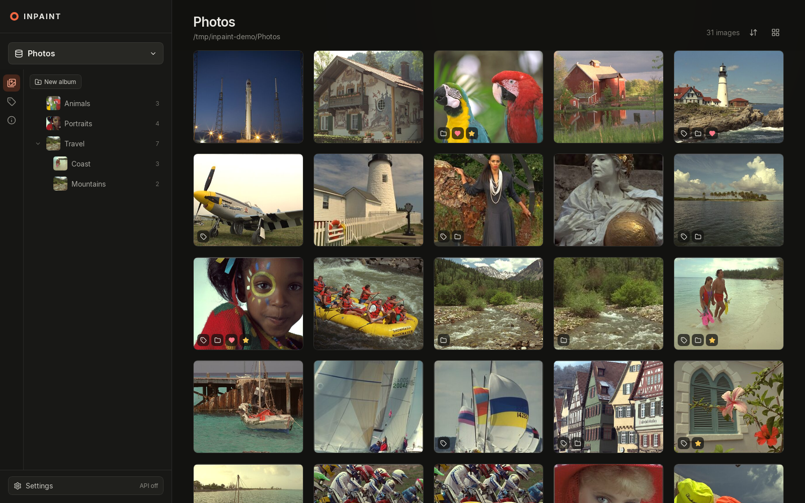](docs/screenshots/gallery.webp) | [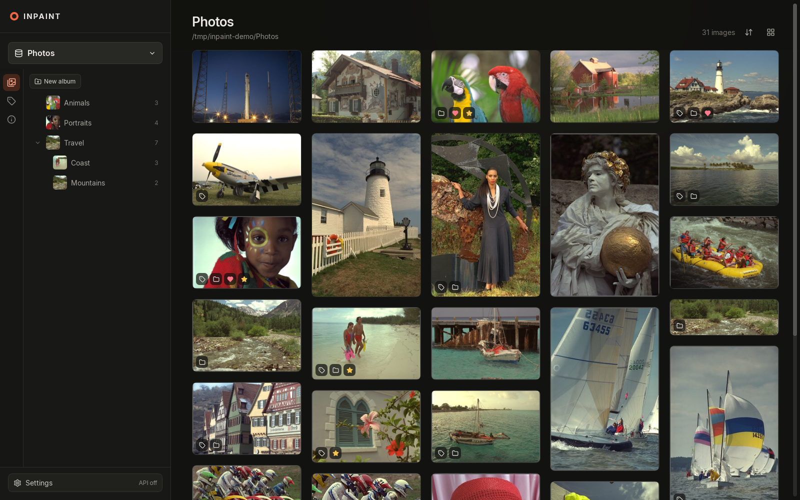](docs/screenshots/masonry.webp) |

Open a folder from the menu at the top of the sidebar, or an image store, and
double-click a picture to edit it. The layout button switches between a grid and
masonry, which keeps each picture's shape, and sets the thumbnail size.

### Image stores

An image store is a folder whose pictures are kept two levels deep under the
first characters of their names, `ab/cd/abcd….jpg`, the way Immich stores
uploads. Open the sidebar menu, choose **New store…**, pick the folder and name
it. The menu then lists your stores below **Open folder…**.

A store shows every PNG, JPG, WebP, GIF, BMP and TIFF picture of all its
subfolders. Videos, sidecar files and files outside the layout are skipped and
counted as other files. The **Info** tab shows the number of pictures, their size
and the last scan, with **Rescan**, **Rename** and **Remove**. Remove only
forgets the store; its folder stays on disk.

Opening a store shows the list saved by its last scan at once and rescans in the
background. The scan reads the top folders in parallel, so a store of 30,000
pictures on a network share takes a few seconds. Thumbnails are cached in
`.cache/thumbnails` in the data directory, up to 2 GB.

Pictures dropped from a browser or file manager straight onto the gallery are
saved into the open store, and into the open album.

### Order and filters

[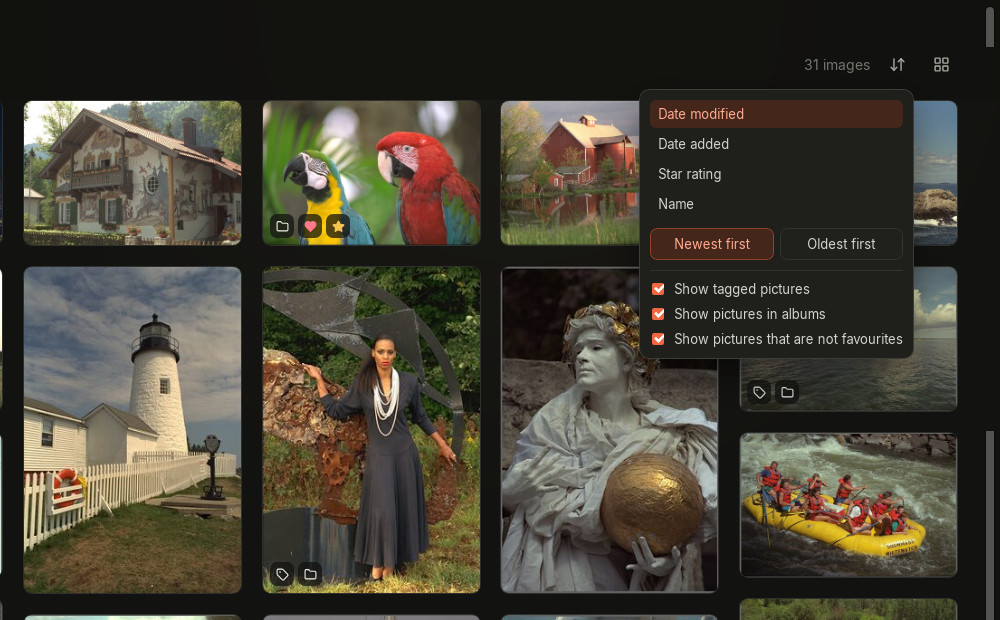](docs/screenshots/order-menu.webp)

The button beside the layout button orders the gallery by **date modified**,
**date added** (when the file was created in the folder, or uploaded, for
Immich), **star rating** or **name**, either way, or in **Random** order. Random
order stays the same while editing, filtering and reopening the app; **Shuffle
again** generates a new order. Its checkboxes leave pictures out:

- **Show tagged pictures**: untick to see only pictures without tags.
- **Show pictures in albums**: untick to see only pictures in no album. It
  appears while every picture of a store is shown.
- **Show pictures that are not favourites**: untick to see only favourites.

The editor's arrows and picture strip follow the same order.

### Albums and tags

The store sidebar has **Albums**, **Tags** and **Info** tabs.

- Albums can hold other albums. Their covers show the newest picture below them
  unless one was chosen, and counts include the albums inside.
- Use an album's **⋮ → Export to folder…** menu to copy all its pictures, including
  nested albums, to a folder on disk. Smart albums export their matching pictures;
  gallery filters do not limit the export. Files keep their saved format and embedded
  metadata, and filename clashes get numbered copies. Immich originals must be
  available on this computer; any files that could not be copied are listed at the end.
- **Smart albums** update automatically from rules: all or any required tags, excluded
  tags, nested tags, favourites, rating range, filename, file types and date added.
  Use **Smart album** in the Albums panel and **Edit rules** in its menu. These
  albums match indexed pictures in the current store without moving files. Rules
  stay in Inpaint, including for Immich stores; **Read tags** refreshes the cached
  Immich tags used for matching.
- Add pictures to an album by dragging them onto it, from a picture's right-click
  menu, or by picking several cards first (click, Ctrl-click, Shift-click) and
  using **Add to album…**, **Tag…** or **New album…** in the bar that appears.
  Inside an album, **Remove from “album”** takes the picked pictures out of it.
- Tags whose names contain `/` form a tree: `location/outside` is `outside`
  inside `location`. Choosing a tag shows its pictures and those of the tags below
  it. The **Tag…** dialog adds several tags at once: pick or type each one and it
  is listed below the field.
- Thumbnails carry small marks: a tag and a folder for pictures that have tags or
  are in albums (hover to see which), a heart for favourites and a star for rated
  pictures, whose tooltip shows the rating, such as `4/5`.

### Immich

For Immich, create a store from one user's upload folder, such as
`/mnt/immich/upload/<user id>`, and check **Immich compatible** in its sidebar.
**Folder as Immich sees it** is the same folder inside the Immich container, by
default `/data/upload/<user id>`; Immich shows it as the file location of a
picture. In **Settings** › **Immich**, or in the store itself, enter the Immich
address and an API key created by the account that owns the pictures, with the
`asset.read`, `asset.update`, `asset.upload`, `asset.delete`, `job.create`,
`tag.read`, `tag.create`, `tag.asset`, `album.read`, `album.create`,
`albumAsset.create` and `albumAsset.delete` permissions.

- After Inpaint saves a picture of such a store, it asks Immich to rebuild the
  thumbnail, and to read the metadata again when the picture's size changed.
- Albums, tags, favourites and ratings are Immich's own. Immich has no album
  tree, so `Trips/2024/Rome` shows as nested albums. Which pictures carry which
  tag is read once with **Read tags** and kept until read again.
- Albums and tags often hold pictures Immich reads from an external library
  rather than from the upload folder, such as `/mnt/photos` on the server.
  Inpaint finds them at the same path on this computer, where folder names may
  differ in case (`/mnt/Photos`), and shows them with the store's own pictures.
- In the editor, the **Info** tab edits the favourite mark, archive, star rating,
  description, tags and albums in Immich, and lists the people Immich recognized
  and the photo's details. **Open in Immich** shows the picture there.
- Deleting a picture moves it to Immich's trash.

## Editing

The editor has the tools on the left, with a rail of icons to jump between them;
the picture in the middle, with the picture strip along the bottom (**S**); and
tabs on the right for **Info**, **Annotations**, **History**, **Workflows**,
**Batch**, **Export** and **Memory** (**Alt+1** to **Alt+7**).

Tool sections can be reordered by dragging their headings or the rail buttons.
Expanded sections, brush settings, model choices, prompts and panel choices
persist between pictures and restarts. Masks, detected faces, crop rectangles and
edit history belong to the current picture and are cleared when you leave it.

### Editor controls

Hover over the `?` button in the lower-left corner of the editor to see these
controls in the application.

| Input | Action |
| --- | --- |
| Left mouse drag | Paint the mask |
| Mouse wheel | Zoom smoothly around the pointer |
| Ctrl + mouse wheel | Change brush size |
| Space + drag or middle mouse drag | Pan |
| Shift + paint | Apply the mask when the stroke ends |
| Space | Apply the current mask, or the selected face preview while comparing |
| Ctrl+Z / Ctrl+Shift+Z | Undo / redo |
| Left / Right or A / D | Previous / next picture, or face preview while comparing |
| Home / End | First / last picture |
| S | Show or hide the picture strip |
| Numpad `*` / Numpad `/` | Fit to window / actual size |
| Numpad `+` / Numpad `-` | Zoom in / out |
| Ctrl+S | Overwrite the current image |
| O | Toggle between the original and edited image |
| Esc | Return to the gallery |
| Enter / Esc while cropping | Apply / cancel the crop |
| Alt+T | Restore detail with the selected mode and strength |
| Alt+U | Upscale using the selected method, scale, and denoising |
| Alt+Z | Downscale to the selected size and filter |
| Alt+F | Restore faces with GFPGAN and the shared strength |
| Alt+P | Preview all saved faces |
| Alt+M / Alt+Shift+M | Find and mark / find and remove watermarks |
| Alt+Shift+E | Generate the extended canvas |
| Alt+Shift+S | Refine selection edges |
| Alt+0 | Collapse / expand the tools panel |
| Alt+R | Replace the selected/largest face with the selected source |
| Alt+B | Remove the background using the selected model |
| Alt+G | Apply the replacement background settings |
| Alt+D | Detect faces for selection |
| Alt+E | Apply background edge refinement |
| Alt+C | Toggle crop and straighten |
| Alt+H / Alt+V | Flip horizontally / vertically |
| Alt+[ / Alt+] | Rotate left / right |

Every shortcut except the arrows, Esc, Space and Ctrl+Shift+Z can be changed in
**Settings** › **Shortcuts**. Action shortcuts also appear on tool buttons and in
the help overlay; they use the current tool settings, including when a section is
collapsed, and are disabled while typing or running an operation. Face preview
navigation stays available while other candidates generate, including when a
comparison button has keyboard focus. Stop generation lives in a separate row
and stays in place when generation finishes.

[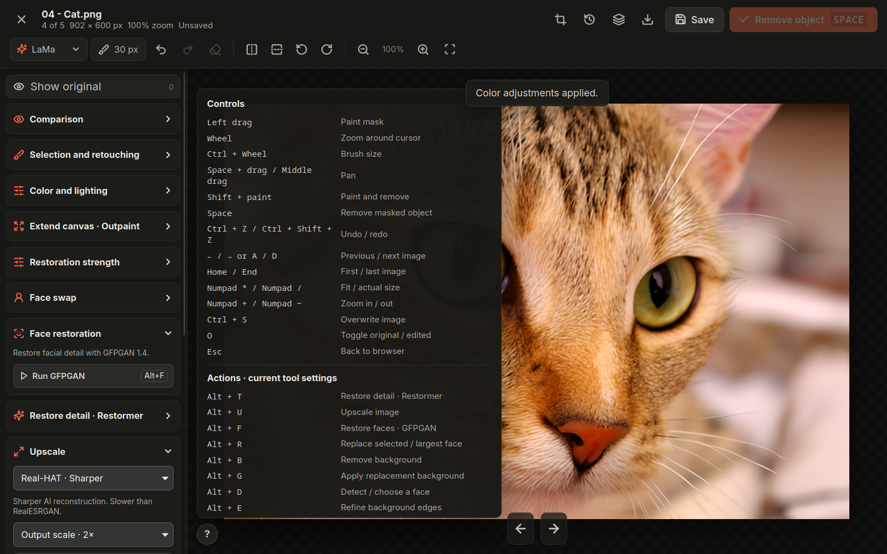](docs/screenshots/shortcuts.webp)

### Selections and retouching

- **Mask brushes** with size, hardness, opacity, an eraser, grow/shrink, and
  feathering. Feathered selections blend the result into the untouched image.
- **Smart selection** with MobileSAM: click to include an object and Alt-click to
  exclude an area, then paint or erase to refine it. Selections are grown by about
  1% of the picture before removal, so the object's edge and shadow go with it.
- **Clone and healing brushes**: Alt-click a source point, then paint a
  destination. Healing keeps sampled texture while matching local lighting.
- Smart selection, and choosing a clone or healing source, show a crosshair
  instead of the brush circle.

### Color, crop, and canvas

| Live color preview | Square crop |
| --- | --- |
| [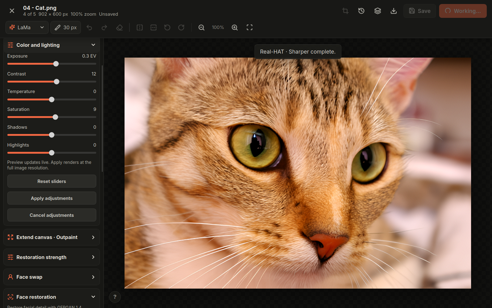](docs/screenshots/color.webp) | [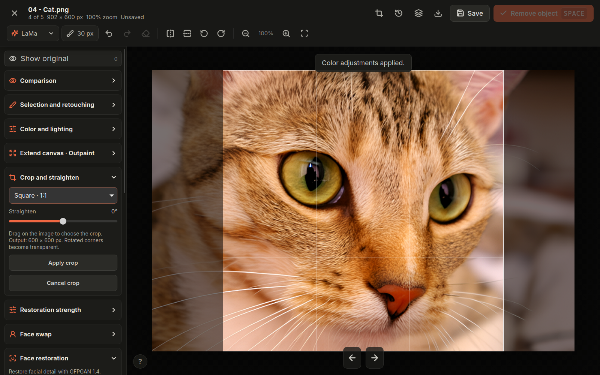](docs/screenshots/crop.webp) |

- **Color and lighting** with live exposure, contrast, temperature, saturation,
  shadows, and highlights previews. Apply renders the full-resolution result.
- **Crop and straighten** (**Alt+C**) with free cropping, common aspect ratios,
  and an angle preview. Drag on the picture to draw the crop, drag its corner and
  side handles to resize it, or drag inside it to move it; with a ratio chosen, it
  keeps its shape. **Enter** applies it and **Esc** cancels. Rotated corners are
  transparent until cropped away.
- **Flips and 90° rotations** from the top toolbar.
- **Downscale** (**Alt+Z**) shrinks a picture so its longest side fits a size,
  with Lanczos, bicubic, area average, Hamming or bilinear resampling.
- **Extend canvas** adds space on any side and fills it with an inpainting model,
  with a prompt for SDXL. Original pixels and transparency stay intact.

[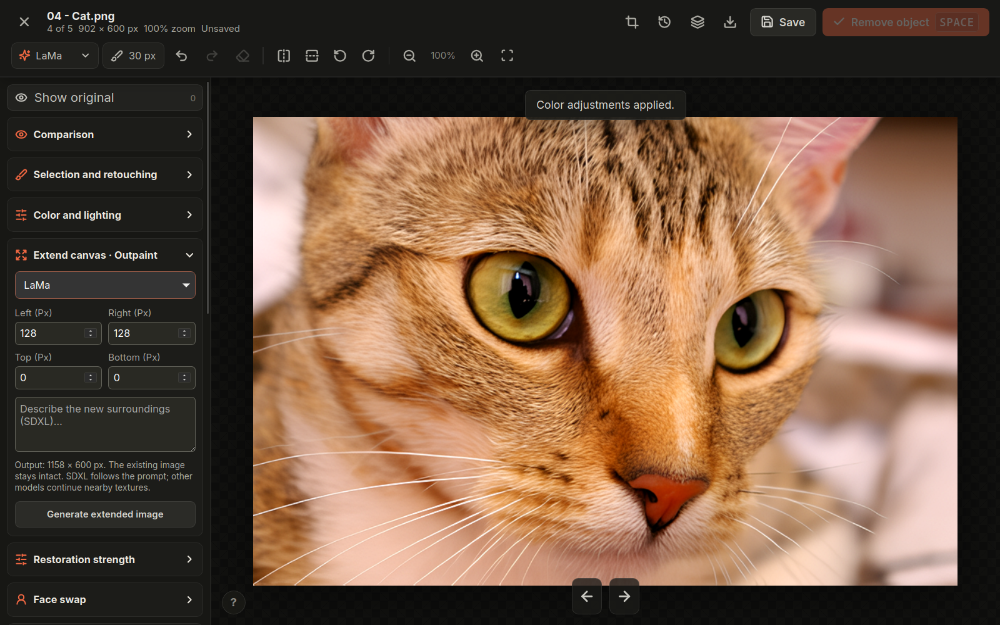](docs/screenshots/outpaint.webp)

### Comparison and history

- **Before/after comparison** against the original or the previous history step,
  with a draggable divider and shared zoom and pan. **O** flips to the original.
- **History** lists named previews of every edit. Selecting a step restores its
  image and dimensions; a new edit discards the steps after it.

| Visual history | Loaded models |
| --- | --- |
| [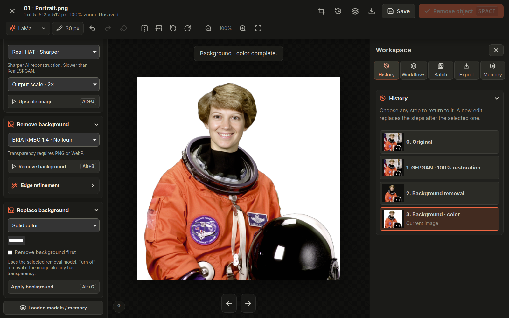](docs/screenshots/history.webp) | [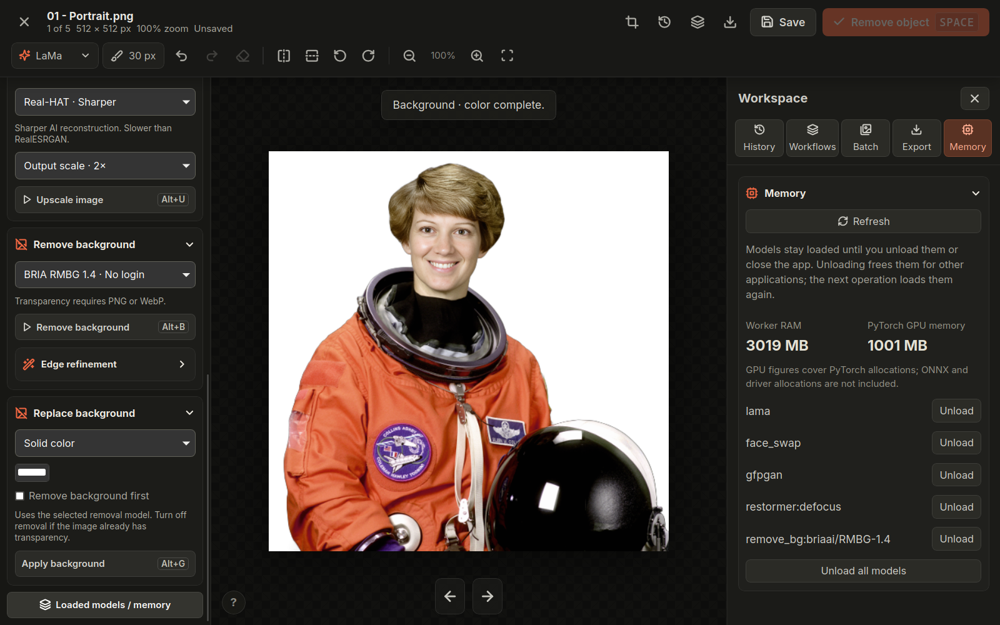](docs/screenshots/memory.webp) |

### Picture details and annotations

- **Info** edits a picture's favourite mark, star rating, description, tags,
  people and albums, and shows its file and camera details. Pictures outside
  Immich keep these in Inpaint's database.
- **Annotations** pins notes to parts of a picture: turn on **Draw a box**, drag
  over the area and write the note. Notes stay faint until the pointer is over
  them or their row in the list.

### Animated GIFs

Animated GIFs play in the gallery while the pointer is over their thumbnail, and
in the editor until the first edit; the label in the top-left corner pauses them.
The editor shows edits on the first frame. Save repeats every edit of the history
on each frame and writes the animation back with its timing. Animations of more
than 1,000 frames or 150 megapixels in all still play, but are saved as a still
picture. BMP and TIFF pictures open as PNG and are saved as a new file.

### Deleting pictures

The bin in the editor's top bar deletes the open picture. It goes to the desktop
trash; where there is none, as on some network shares, Inpaint asks before
deleting it permanently. Pictures of Immich-compatible stores go to Immich's
trash instead.

## AI tools

All models are provided by their upstream projects. Their weights have separate
licenses and terms; see [Third-party software and models](THIRD_PARTY_NOTICES.md)
and review the linked sources before redistributing them.

### Object removal

| Paint the mask | Apply inpainting |
| --- | --- |
| [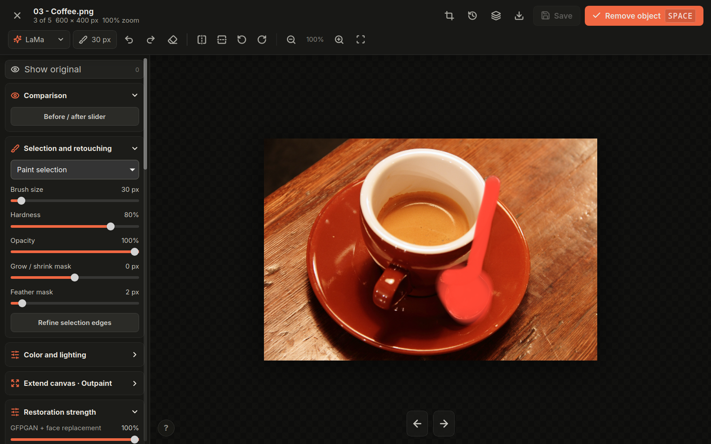](docs/screenshots/object-mask.webp) | [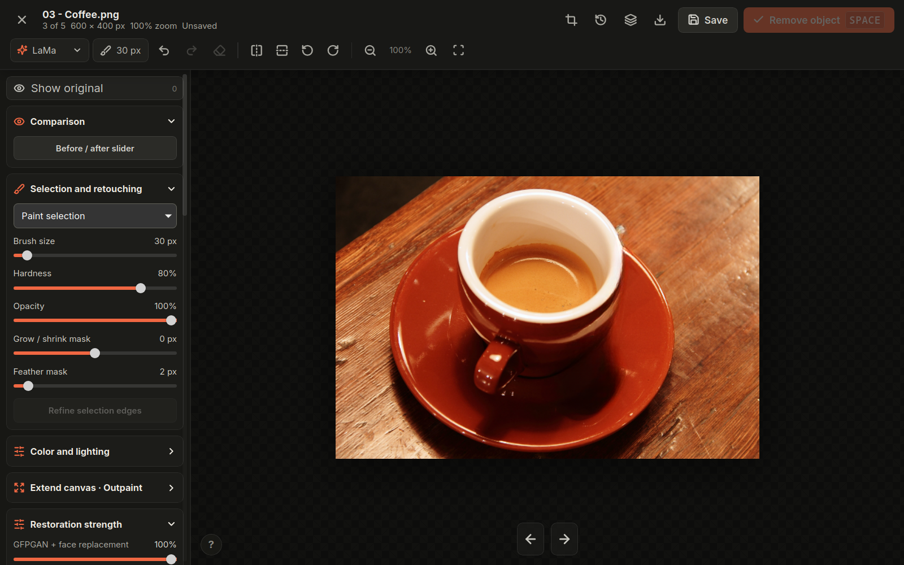](docs/screenshots/object-result.webp) |

Paint over the unwanted object, or select it with smart selection, then press
**Space**. Hold Shift while painting to remove the object as soon as you release
the mouse. Choose the model in the top bar:

| Model | Best for | Download source |
| --- | --- | --- |
| **LaMa** | Fast general-purpose object removal, people, blemishes, and natural textures | [`big-lama.pt`](https://github.com/enesmsahin/simple-lama-inpainting/releases/download/v0.1.0/big-lama.pt) from [simple-lama-inpainting](https://github.com/enesmsahin/simple-lama-inpainting) |
| **MAT** | Large masks, landscapes, rooms, and broader scene reconstruction | [`Places_512_FullData_G.pth`](https://github.com/Sanster/models/releases/download/add_mat/Places_512_FullData_G.pth), distributed by IOPaint; original [MAT project](https://github.com/fenglinglwb/MAT) |
| **ZITS** | Architecture, fences, horizons, edges, and straight structural lines | Four [ZITS checkpoints](https://github.com/Sanster/models/releases/tag/add_zits), distributed by IOPaint; original [ZITS project](https://github.com/qianyuezqy/ZITS_inpainting) |
| **MIGAN** | Quick small or medium repairs on uncomplicated backgrounds; internally works with 512px crops | [`migan_traced.pt`](https://github.com/Sanster/models/releases/download/migan/migan_traced.pt), distributed by IOPaint; original [MI-GAN project](https://github.com/Picsart-AI-Research/MI-GAN) |
| **SDXL Inpainting** | Slower, prompt-guided generation when a region needs new semantic detail | [`diffusers/stable-diffusion-xl-1.0-inpainting-0.1`](https://huggingface.co/diffusers/stable-diffusion-xl-1.0-inpainting-0.1) and the [`sdxl-vae-fp16-fix`](https://huggingface.co/madebyollin/sdxl-vae-fp16-fix) VAE from Hugging Face |

LaMa is approximately 197 MB. MAT, ZITS, and MIGAN are downloaded on demand
through IOPaint. SDXL is a multi-gigabyte download.

### Watermark removal

| Find and mark | Remove |
| --- | --- |
| [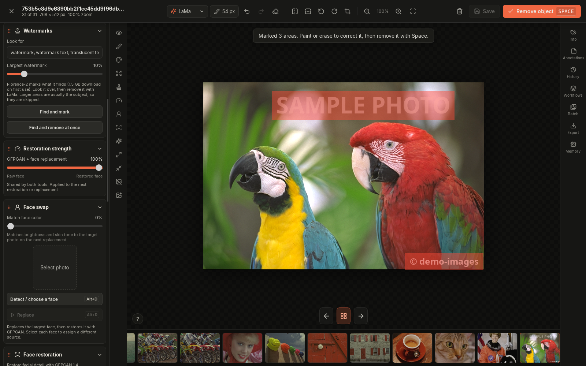](docs/screenshots/watermark-marked.webp) | [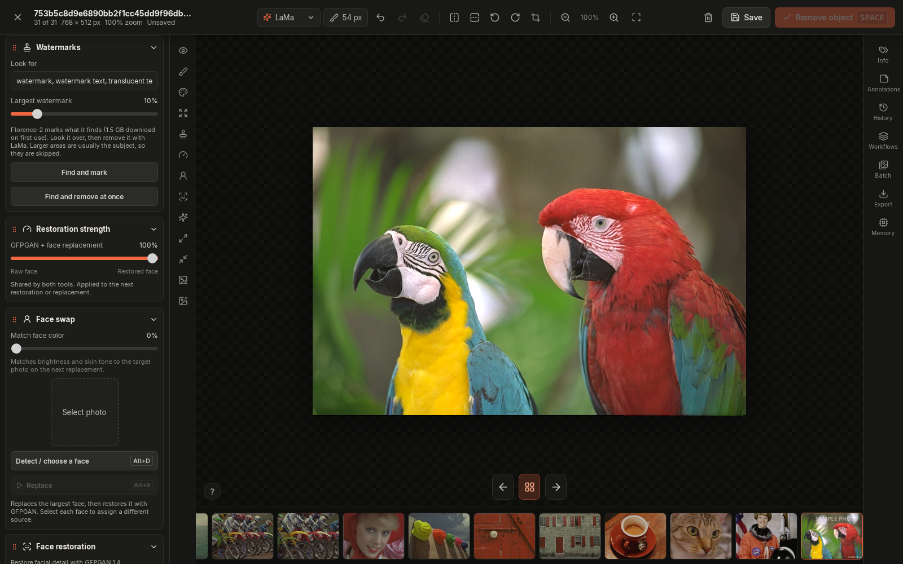](docs/screenshots/watermark-removed.webp) |

The **Watermarks** section finds watermarks with
[Florence-2](https://huggingface.co/microsoft/Florence-2-large), the way
[WatermarkRemover-AI](https://github.com/D-Ogi/WatermarkRemover-AI) does, and
removes them with the inpainting model chosen in the top bar.

- **Look for** takes phrases separated by commas. Each phrase finds one mark; the
  default `watermark, watermark text, translucent text overlay` finds large
  translucent words, small corner credits and logos between them. Add your own,
  such as `Getty Images` or `logo`.
- **Largest watermark** skips boxes that cover more of the picture than this
  (10% by default), since those are usually the subject.
- **Find and mark** puts what it found into the mask. Paint or erase to correct
  it, then press Space to remove it. Detection can mistake logo-like parts of a
  picture for a watermark, or miss part of one over a busy background, so looking
  first is safer.
- **Find and remove at once** does both. It is also a workflow step for batch
  processing and the `remove-watermarks` API operation.

Florence-2 (1.5 GB) downloads on first use and stays loaded like other models.

### Upscaling

[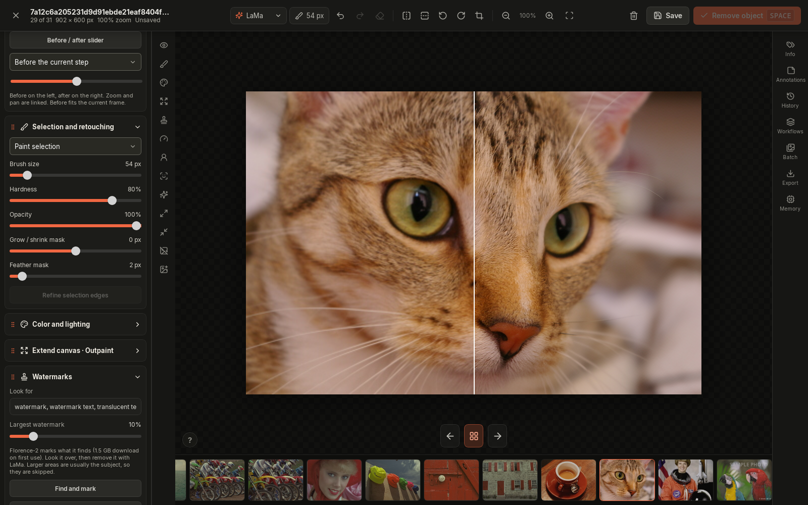](docs/screenshots/upscale-comparison.webp)

The Upscale section (**Alt+U**) offers 2×, 3×, and 4× output for every method.
The first two keep a photo's own texture instead of smoothing it into a plastic
look:

| Method | Best for | Download |
| --- | --- | --- |
| **DAT2 · Natural photos** | Most photos, including JPEGs from phones and the web | 140 MB |
| **ATD · Finest detail** | Clean sources such as PNG or camera exports. It sharpens JPEG artifacts, so use DAT2 for compressed pictures | 82 MB |
| **Real-HAT · Sharper** | Sharper AI reconstruction; smoother textures | 170 MB |
| **RealESRGAN x4+ · Photos**, **General v3**, **Anime 6B** | Fast general, photo and illustration upscaling | on demand |
| **Lanczos · No AI** | Ordinary resizing without AI reconstruction | none |

DAT2 and ATD are `4xRealWebPhoto_v4_dat2` and `4xNomos2_hq_atd` by
[Philip Hofmann](https://github.com/Phhofm/models) (CC-BY-4.0). Measured on photos
shrunk to a quarter and enlarged again, RealESRGAN and Real-HAT kept 43–52% of
the original fine detail, DAT2 about 60–66% and ATD about 84–92%, while matching
the original at least as closely. They are slower than RealESRGAN: about 8
seconds for a 768×512 picture enlarged 2× on an RTX 4090.

**General v3** has a **Denoising** slider: 0% uses the weak-denoising model to
retain more texture and noise; 100% uses the strong-denoising model. Real-HAT uses
the official `Real_HAT_GAN_sharper.pth` checkpoint from
[XPixelGroup/HAT](https://github.com/XPixelGroup/HAT). The transformer upscalers
work in tiles to limit GPU memory use, and their native 4× output is resized with
Lanczos when 2× or 3× is selected. Their weights download into
`models/torch/hub/checkpoints/`.

### Restore detail

| GFPGAN | Restore detail |
| --- | --- |
| [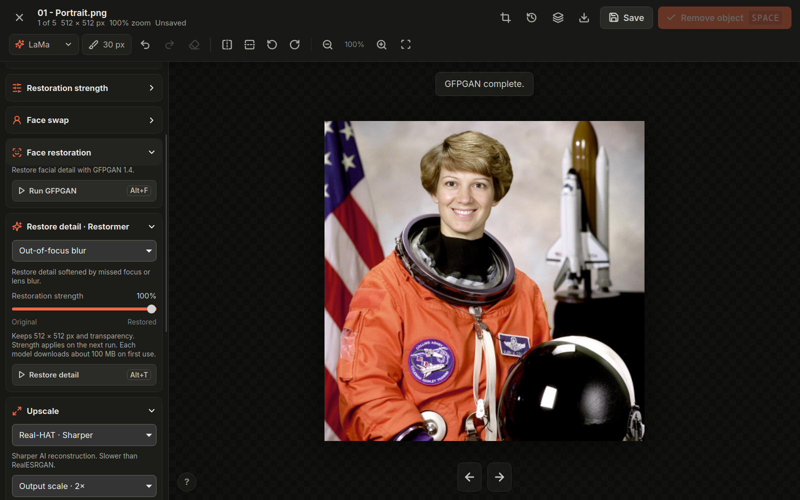](docs/screenshots/gfpgan.webp) | [](docs/screenshots/restormer.webp) |

**Restore detail** (**Alt+T**) repairs the current image at its existing
resolution. Choose the mode that matches the picture:

| Mode | What it does | Downloads on first use |
| --- | --- | --- |
| **Compressed or soft photo** (default) | Removes JPEG blocks and ringing with [FBCNN](https://github.com/jiaxi-jiang/FBCNN), then adds detail with Real-ESRGAN 2× and shrinks the result back to the original size. Best for pictures saved from the web. | FBCNN (275 MiB), Real-ESRGAN 2× (64 MiB) |
| **Natural detail** | FBCNN, then Real-HAT 4×, shrunk back. Finer, more natural detail; slower. | FBCNN, and Real-HAT (162 MiB) unless the upscaler already downloaded it |
| **JPEG artifacts only** | FBCNN alone, without sharpening. | FBCNN |
| **Photo noise** | Removes grain and color noise with [SCUNet](https://github.com/cszn/SCUNet), trained on real camera noise. | SCUNet (69 MiB) |
| **Motion blur** | Restormer's motion deblurring model. | Restormer (100 MiB) |

Strength blends the result with the original and applies on the next run. Image
dimensions and transparency are preserved.

Real-ESRGAN and Real-HAT were trained on realistically degraded photos, so
enlarging a picture with them and shrinking the result back leaves sharper edges
and texture at the original size. Measured against the clean originals of shrunk,
JPEG-compressed and slightly blurred test photos, cleaning compression first and
then adding detail came closest. Restormer's defocus and noise models, which this
section used before, made compressed pictures worse and were removed; saved
workflows and API requests that name them run **Compressed or soft photo** and
**Photo noise** instead. Detail modes add plausible texture: they cannot bring
back detail that is completely gone.

Networks stay loaded once used, so modes that share FBCNN load it once. They
process overlapping tiles to limit GPU memory use; if the GPU runs out of memory,
they retry with smaller tiles, then continue on the CPU, which is slower. The
maximum input size is 64 megapixels. Restormer's architecture is included in the
app's runtime, with its upstream MIT license.

### Faces

[](docs/screenshots/face-result.webp)

This is an **altered demonstration image**, combining NASA portraits of Neil
Armstrong and Eileen Collins.

- **GFPGAN 1.4** (**Alt+F**) restores facial detail.
- **Face replacement** (**Alt+R**): click the square **Select photo** picker and
  choose a PNG, JPEG, or WebP with the face to use, then click **Replace**. The
  largest face in the source photo replaces the face you selected, or the largest
  face if none is selected, and GFPGAN restores it. Replacement and restoration
  form one undoable edit and keep the image's dimensions and transparency.
- **Face selection** (**Alt+D**): detect faces, click a numbered face, then
  choose its source photo. Different faces can have different sources.
- **Face color matching** adjusts brightness and skin tone on the next
  replacement.
- **Shared restoration strength** for GFPGAN and face replacement. After either
  operation, the slider blends the raw and restored result without another model
  run.
- **Saved faces**: every photo you choose is kept. Hover the tab beside the photo
  picker to open them. Click a photo or its eye button to preview it, **▷** to
  commit a replacement directly, or the bin to remove it. **Add photos** saves
  several at once. Each store remembers its own saved faces and selected source;
  switching stores restores those choices. Folder browsing has a separate list.
  On upgrading from the shared list, existing choices are kept with the store
  that was last open (or the folder workspace if no store was selected).
- **Compare saved faces**: switching photos previews each on the same starting
  picture, without stacking replacements. **Preview all faces** generates a
  candidate for every saved face. Browse with the arrows, compare with **Original**,
  then **Use this** (**Space**) to add one undoable edit or **Discard all** (**Esc**)
  to keep your starting picture and close the comparison. A completed preview can
  be applied while others are still generating. Save separately when ready.
  In Saved faces, choose **Preview generation → 2 at a time** to generate two
  candidates concurrently in separate model processes. This uses more GPU memory;
  **1 at a time** is the default. First-use model preparation finishes before
  parallel work starts, and the extra process releases its memory after the batch.
  Stop generation finishes only the faces already running; failed faces do not
  prevent comparing the others.

Face replacement uses [InsightFace's INSwapper](https://github.com/deepinsight/insightface/tree/master/examples/in_swapper);
its weights go in `models/faceswap/` and have their own license terms. To
reinstall its dependencies in a source checkout, run `./scripts/setup-face-swap.sh`.
To copy weights from an existing installation, set `FACE_SWAP_PROJECT_DIR` to a
directory containing `models/inswapper_128.onnx` and `INSIGHTFACE_MODELS_DIR` to
the directory containing the `buffalo_l` models before running it.

### Background removal and replacement

| Transparent cutout and edge controls | Replace the background |
| --- | --- |
| [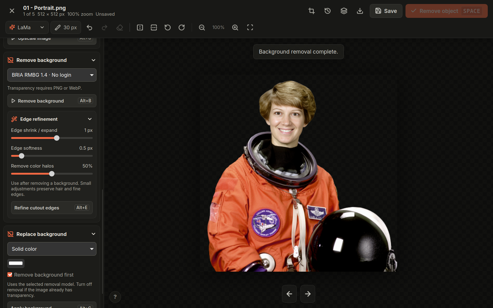](docs/screenshots/background-result.webp) | [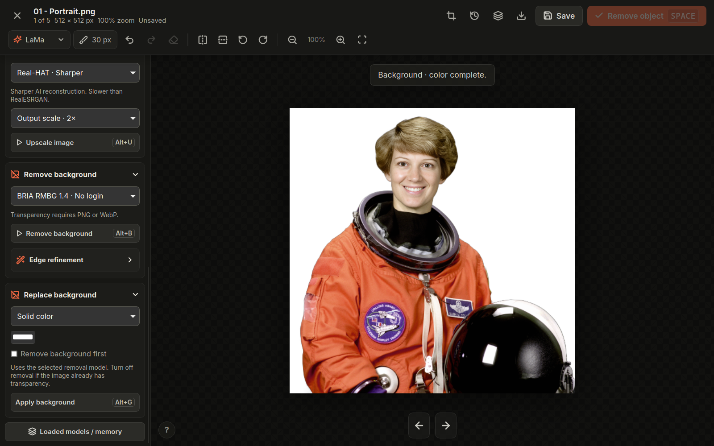](docs/screenshots/background-replace.webp) |

- **Background removal** (**Alt+B**) with BRIA RMBG 1.4/2.0 and U²-Net
  general/human models.
- **Edge refinement** (**Alt+E**) with shrink/expand, softness, and color-halo
  removal using nearby opaque foreground colors.
- **Background replacement** (**Alt+G**) with a color, an image, or a blurred
  original. The optional first removal step uses the model selected in the panel.

BRIA 1.4 works without a login. To use BRIA 2.0, open **Set up model access**
below its dropdown, request access on Hugging Face, and save a read token from
the approved account. The token is stored locally with access limited to your
Linux user. Use PNG or WebP to keep a transparent background; JPEG does not
support transparency.

## Workflows, batch processing, and export

| Build a workflow | Queue pictures |
| --- | --- |
| [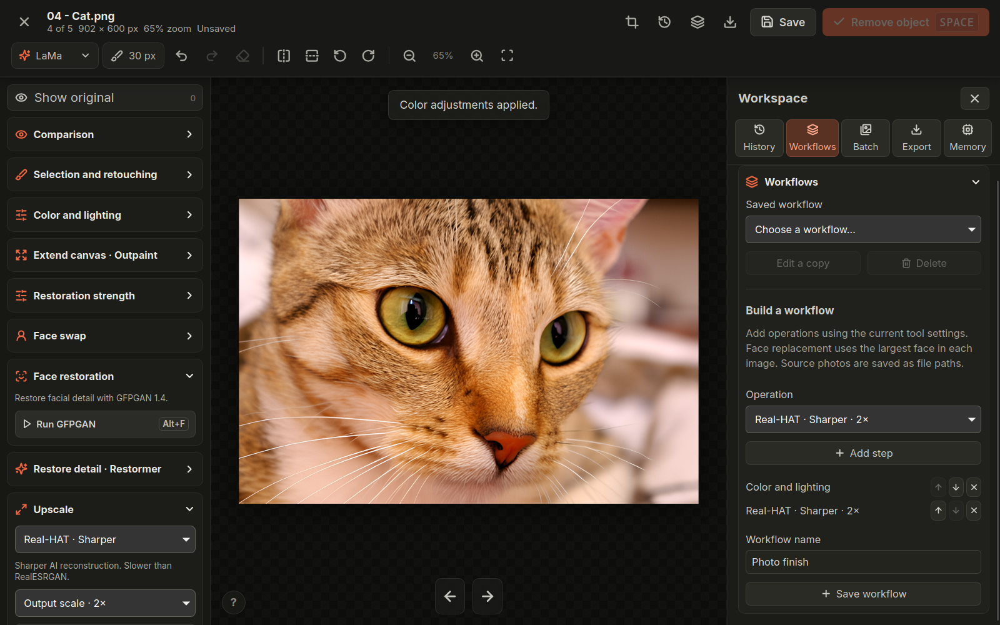](docs/screenshots/workflows.webp) | [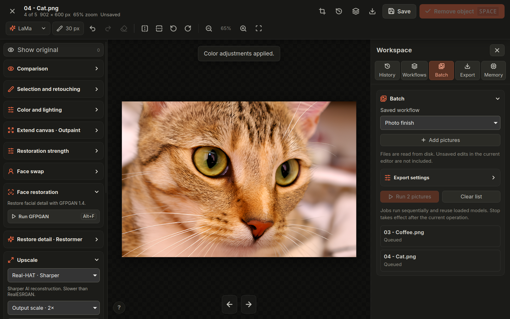](docs/screenshots/batch.webp) |

- **Workflows** save ordered operations with the current tool settings. Add,
  reorder, and remove steps, then save a named workflow. Referenced source photos
  and background images must remain at their saved paths; reusable face swaps
  select the largest face in each image.
- **Batch** applies a saved workflow to many pictures in turn, reusing loaded
  models, with progress and errors per file. Stop takes effect after the current
  operation. Batch reads pictures from disk, independently of unsaved editor changes.
- **Export** writes PNG, JPEG, or WebP copies with quality, dimensions (0 = auto),
  a filename suffix, and a JPEG transparency fill color. Files are never
  overwritten: collisions receive numbered names.
- **Memory** lists loaded models and worker RAM, with individual and all-model
  unload controls. GPU figures cover PyTorch allocations, not ONNX/driver ones.

[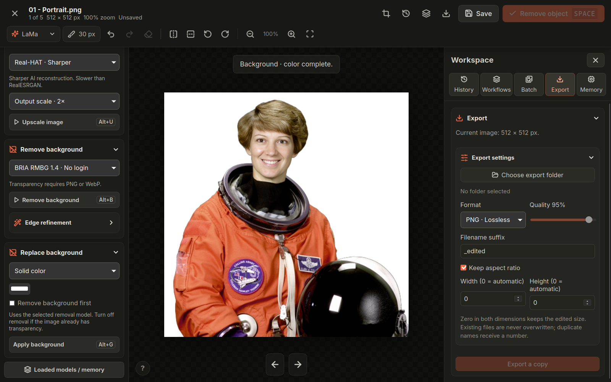](docs/screenshots/export.webp)

## Drop box

The drop box is a translucent area in a corner of the screen that saves pictures
into an image store. Turn it on in **Settings** › **Drop box**, and choose the
store, the album each store's pictures join, the screen, its size and its opacity.

It stays invisible and lets clicks through until you hold **Win+Ctrl**: drag a
picture from the browser, a file manager or any other program, hold the keys and
drop it. While holding them, press **V** to save the picture on the clipboard.
**Always visible** keeps it shown. Right-click it, or use the tray's **Drop box**
menu, to change the store or save the clipboard.

- Pictures dragged from Chromium-based browsers such as Vivaldi, or from Firefox,
  are saved from the browser's own copy, so pictures behind a login work too.
  Local files are copied, and dropped links are downloaded; a link to a page saves
  the picture the page shows.
- Only pictures are accepted. They are named after their SHA-1,
  `ab/cd/<sha1>.jpg`, and a picture whose hash is already in the store is skipped.
- Immich-compatible stores get the picture uploaded through Immich, which files it
  and skips pictures it already has.
- **Clear metadata**, in the drop box settings or its right-click menu, is saved
  separately for each store and is off by default. It removes embedded tags, ratings,
  notes, dates, GPS and camera details from a temporary copy before hashing and
  saving/uploading. Orientation and colour information are kept; original files
  are unchanged. It also applies to clipboard, link and main-window drops into that
  store. Install ExifTool to use it. If cleanup fails, the original is saved/uploaded
  as-is and the drop report says its metadata was kept. Existing Immich assets are
  not modified.
- The area flashes green when a picture is saved, amber when it was already there,
  and red when saving failed, with the reason shown for a few seconds. Pictures
  saved into the open store, or its open album, appear in the gallery at once.

Inpaint prefers X11 (XWayland on a Wayland desktop) so the drop box can use its
configured position, stay above other windows and stay out of the taskbar, and
the main window uses the desktop's normal title bar. If X11 is unavailable, it
falls back to the available display backend. `GDK_BACKEND` overrides this choice;
forcing `GDK_BACKEND=wayland` disables those drop box window controls.
Holding the keys needs an X11 session; on Wayland, keep the drop box always visible,
since XWayland cannot reliably watch keys pressed in native Wayland applications.

## Local API server

Other programs can send pictures to the running app over HTTP. Click
**Settings** in the browser's sidebar to enable it, choose between `127.0.0.1`
and all network interfaces, copy the access token, and allow the folders that
requests may read and write.

Every editor operation has an endpoint, such as `POST /upscale`,
`POST /remove-watermarks` or `POST /face-swap`. `POST /workflow/{name}` runs a
saved workflow, `POST /load` opens a picture in the editor, and `POST /save`
writes a picture to disk. Pictures can be sent as bytes, URLs or disk paths.

```bash
curl -H "Authorization: Bearer $TOKEN" -H "Content-Type: application/json" \
  -d '{"image": "/home/me/Pictures/cat.jpg", "options": {"scale": 2}}' \
  -o cat-2x.jpg http://127.0.0.1:7865/upscale
```

See the [API reference](docs/server-api.md) for every endpoint and option.

## Browser extension

`browser-extension/` holds an extension for Chromium browsers (Chrome, Vivaldi,
Brave, Edge, Opera) that sends pictures from web pages and from Immich to Inpaint
through the local API server, and shows the results in place. Its
[README](browser-extension/src/inpaint/README.md) covers setup and use.

### Install it unpacked

No build is needed:

1. Open `chrome://extensions` (`vivaldi://extensions` in Vivaldi).
2. Turn on **Developer mode**.
3. Click **Load unpacked** and choose the `browser-extension` folder.

After changing the extension's files, click the reload button on its card.

### Build a package

```bash
./build-extension.sh
```

The script needs only Node.js and writes two files to the project root:

| File | Use |
| --- | --- |
| `inpaint-extension.crx` | Signed package, installed by dragging it onto the extensions page |
| `inpaint-extension.zip` | The same files unsigned: unzip it and load the folder unpacked on another machine |

To install the `.crx`, turn on **Developer mode** on the extensions page, drag
the file onto the page and confirm. Chromium browsers on Linux accept this;
Chrome on Windows and macOS only keeps extensions from the Chrome Web Store. To
update, raise `version` in `browser-extension/manifest.json`, build again and
drag in the new file. Its settings are kept.

Every build has the same extension ID, so a new `.crx` updates the installed
copy, and an unpacked copy uses the same ID and settings too. The ID comes from
the `"key"` field in `manifest.json`, which is the public half of a signing key:

- The first build creates the key at `~/.config/inpaint/extension-key.pem`,
  writes its public half into `manifest.json`, and asks you to commit that change.
- Later builds check that they sign with the matching key and stop otherwise, so
  no package can come out with another ID.
- Keep the key private and back it up. Without it, no update can be built for
  installed copies. On another machine, copy it to the same place or pass `--key`.
- Loading the folder unpacked needs no key, and it still gets the same ID.

Options: `--key FILE` (or `INPAINT_EXTENSION_KEY`) signs with another key, and
`--out FOLDER` writes the packages elsewhere. The build stops when
`manifest.json` names a file that does not exist.

Firefox is not supported. The extension runs its background code as a Chromium
service worker, and release versions of Firefox only install `.xpi` packages
signed by Mozilla.

## System tray

Inpaint shows a tray icon so it can keep serving API requests in the background.
Its menu has **Start server** / **Stop server**, a **Minimize to tray** checkbox,
a **Drop box** menu and **Exit**. With **Minimize to tray** checked (the default),
closing or minimizing the window hides it in the tray; click the icon to bring it
back. Unchecked, closing the window exits the app.

Only one copy of Inpaint runs at a time. Starting it again brings the running
window back, including from the tray, so a second copy never competes for the API
server's port.

The icon uses the StatusNotifierItem protocol, which KDE Plasma and most Linux
desktops show natively. GNOME needs the AppIndicator extension. Without a tray,
closing the window always exits.

## Build an executable or package

### Plain Linux executable

```bash
./build.sh
./inpaint-desktop
```

`build.sh` builds the frontend and optimized desktop application, verifies that
the executable can read its embedded `index.html` and referenced scripts and
styles, then copies it to `inpaint-desktop` in the project root, replacing an
existing copy. It can be invoked from any working directory. If the build or
asset check fails, the existing root executable is preserved. Restart a running
app to use the update.

The frontend is embedded; `dist/` is not needed beside the executable. To check
the embedded assets without opening a window, run `./inpaint-desktop --check-assets`.

The executable still needs the host's Linux desktop libraries and only runs on
systems at least as new as the one that built it. In a configured source
checkout, it reuses the adjacent `.venv/` and `models/`; on a fresh machine, the
setup screen installs the Python runtime as described under [AppImage](#appimage).

### AppImage

```bash
./build-portable.sh
./inpaint-desktop.AppImage
```

An AppImage only runs where glibc is at least as new as on the system that built
it, so the script builds it inside an Ubuntu 22.04 container with Docker or
Podman. The first build creates the container image from
`scripts/appimage/Containerfile` (a few GB) and compiles everything once; later
builds reuse the image and the caches in `src-tauri/target/appimage/`. The build
stops if a bundled library needs a glibc newer than 2.35, and otherwise copies the
AppImage to the project root. To free the space, delete
`src-tauri/target/appimage/` and run
`docker image rm inpaint-appimage-builder:ubuntu-22.04` (or `podman image rm`).
Distribute `inpaint-desktop.AppImage`; Python dependencies install during setup,
and model weights download when first used, outside the AppImage.

### DEB or RPM

Create a distribution package only if system installation is desired:

```bash
# Debian and Ubuntu
npm run tauri -- build --bundles deb

# Fedora and other RPM-based distributions
npm run tauri -- build --bundles rpm
```

DEB and RPM packages install the binary, desktop entry, and icons into system
locations such as `/usr/bin` and `/usr/share`. The first-launch setup installs the
Python runtime in the user's app data directory. Set `INPAINT_PROJECT_DIR` to
reuse a prepared runtime directory. `npm run tauri -- build` builds every package
format configured in `src-tauri/tauri.conf.json`, below
`src-tauri/target/release/bundle/`.

## License

Inpaint is licensed under the [GNU Affero General Public License, version 3](LICENSE)
(`AGPL-3.0-only`). Copyright (c) 2026 Inpaint contributors.

The face-swap integration was adapted from a local project based on
[Deep-Live-Cam](https://github.com/hacksider/Deep-Live-Cam). Its upstream credits
and license are recorded in the
[code provenance notes](THIRD_PARTY_NOTICES.md#face-swap-code-provenance).

When publishing executables or AppImages, provide the corresponding source for
that exact release, including build scripts, alongside the download. Include
`LICENSE` and `THIRD_PARTY_NOTICES.md` with the release and retain upstream notices.
Modified versions offered for remote use over a network must also offer their
corresponding source to those users, as required by section 13 of the license.
Inpaint is provided without warranty; see `LICENSE` for the full terms.

Libraries, model weights, and screenshot photos retain their upstream licenses.
Some models are restricted to non-commercial use or research. See
[Third-party software and models](THIRD_PARTY_NOTICES.md) for the license notes
and links to their terms.

## Technology

- [Tauri 2](https://tauri.app/) and Rust
- React, TypeScript, and Vite
- PyTorch with CUDA
- [IOPaint](https://github.com/Sanster/IOPaint)
- [simple-lama-inpainting](https://github.com/enesmsahin/simple-lama-inpainting)
- [spandrel](https://github.com/chaiNNer-org/spandrel)
